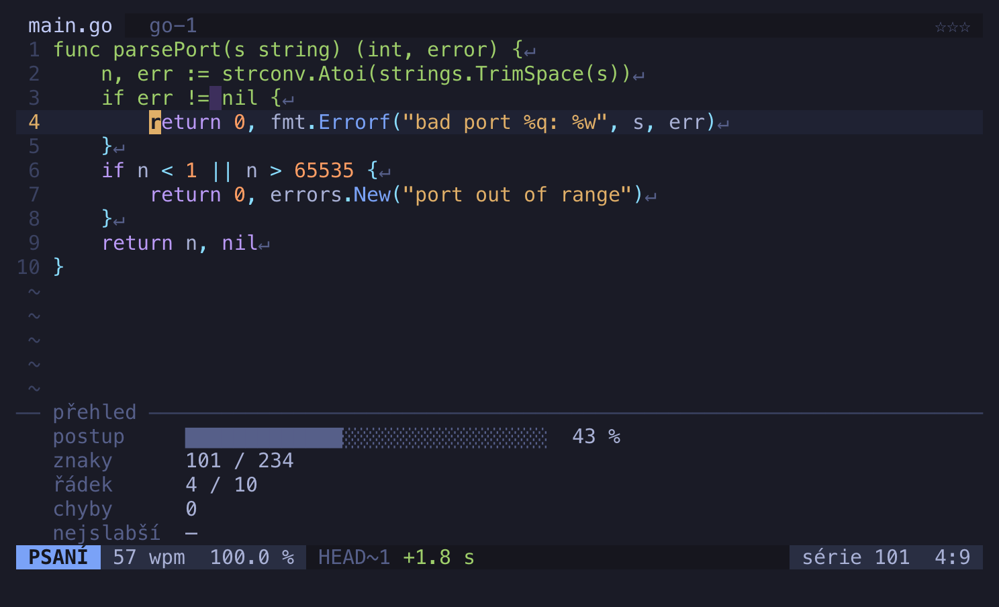

# tuipe

macOS and Linux:

```sh
curl -fsSL https://raw.githubusercontent.com/jiripisa/tuipe/main/install.sh | sh
```

Windows (PowerShell):

```powershell
irm https://raw.githubusercontent.com/jiripisa/tuipe/main/install.ps1 | iex
```

Go developers:

```sh
go install github.com/jiripisa/tuipe/cmd/tuipe@latest
```

Then run `tuipe`.

> **tuipe** je terminálový trenažér psaní všemi deseti pro programátory na české
> klávesnici QWERTY. Vede vás od domovské řady přes diakritiku a číslice až
> k symbolům za klávesou Option a ke skutečnému kódu. Závodíte se svým nejlepším
> pokusem, hasíte incidenty s hořícím SLA a kolo se vejde do čekání na build.
> Celá aplikace je česky. Návod najdete v [manuálu](https://jiripisa.github.io/tuipe/manual.html).



## What it is

A touch-typing trainer for programmers, in the terminal. Most typing tutors stop
at letters. On a Czech keyboard the real pain is everything else: digits sit
behind Shift, `{` sits behind Option, and `ď` takes two keystrokes. Those
characters are the core of tuipe, not a bonus chapter.

- **Career path** of 13 chapters from the home row to real Go, Python, JS/TS,
  shell, SQL and regex, with ranks from Intern to Principal.
- **Ghost `HEAD~1`:** a second cursor replays your best attempt on the same text.
- **Incidents:** timed rounds with an SLA that burns down, and a blameless
  postmortem when you lose.
- **Short or long:** a quick run takes about a minute, a Sprint takes up to 30.
- **Hints that fade** as you learn, and three stars that demand speed and
  accuracy at once.
- **Three styles** (Fosfor, Editor, Velín), switched with `Ctrl+T` at any moment.
- **Statistics** styled as `git log`, with a heatmap, trends, records and
  `uptime`.
- **No accounts and no telemetry.** Your data stays on your machine.

The app and its [manual](https://jiripisa.github.io/tuipe/manual.html) are in
Czech. The website is at <https://jiripisa.github.io/tuipe/>.

## Platforms

The first version is tuned on macOS, for the macOS Czech QWERTY layout.

Linux and Windows binaries exist, on arm64 and amd64, but they ship no layout of
their own. On those systems the app says so, explains how to add a layout file,
and lets you continue with the macOS layout. The hints then describe macOS keys,
which may not match your keyboard. See [`docs/layouts.md`](docs/layouts.md).

## Commands

| Command | Purpose |
|---|---|
| `tuipe` | Start the trainer |
| `tuipe upgrade` | Update to the latest release |
| `tuipe upgrade --check` | Only report whether a newer version exists |
| `tuipe version` | Print the version, commit and build date |
| `tuipe help` | Show usage |

During a round every printable key is input, so the controls are `Esc` (pause),
`Ctrl+R` (restart) and `Ctrl+T` (next style). `Ctrl+C` quits from any screen.

`tuipe upgrade` works for installs from a release. A `go install` build tells you
to run `go install` again instead.

## Terminal setup: Option must type characters

On the Czech layout `{`, `@` and the other symbols are typed with Option. Some
terminals treat Option as Meta or Alt, and then `{` never arrives. tuipe notices
this on first launch and shows the fix for your terminal.

| Terminal | Setting |
|---|---|
| Terminal.app | Settings › Profiles › Keyboard: turn off `Use Option as Meta key` |
| iTerm2 | Settings › Profiles › Keys › General: `Left Option key = Normal`, `Right Option key = Normal` |
| Ghostty | `macos-option-as-alt = false` |
| kitty | `macos_option_as_alt no` in `kitty.conf` |
| WezTerm | `config.send_composed_key_when_left_alt_is_pressed = true` in `wezterm.lua` |
| Alacritty | `option_as_alt = "None"` in the `[window]` section of `alacritty.toml` |

Reload or restart the terminal afterwards.

## Data

| What | Where |
|---|---|
| Config | `~/.config/tuipe/config.toml` |
| Your layouts | `~/.config/tuipe/layouts/*.toml` |
| Progress, history, ghosts | `~/.local/share/tuipe/` |

`XDG_CONFIG_HOME` and `XDG_DATA_HOME` are honoured on every system. These are
plain JSON and TOML files. The app goes online only for `tuipe upgrade` and for a
background check for a new version, at most once a day, which you can turn off in
settings.

To uninstall, delete the binary and those two folders. The
[manual](https://jiripisa.github.io/tuipe/manual.html#odinstalace) has the
commands for each system.

## Keyboard layouts

A terminal reports the character a key produced, not the key, so tuipe needs the
exact layout to teach it. Layouts are data files.
[`docs/layouts.md`](docs/layouts.md) describes the format, how to dump a macOS
layout, where to put your own file and how to contribute one.

## Development

```sh
go test ./...
go run ./cmd/tuipe
```

`sh scripts/render-screenshots.sh` regenerates the pictures in `site/assets` from
the real app. It needs [Playwright](https://playwright.dev).

## License

[MIT](LICENSE)
